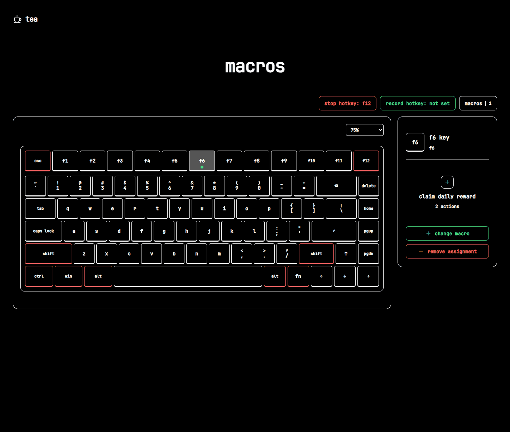

# Tea, Macro Tool

#### This tool was made for various types of desktop automation and has some unique features that I could not find readily available elsewhere. Everything is done locally. Note: this tool was created exclusively for Windows, and may support other operating systems in the future.



# Features

- Simple UI
- Streamlined macro building
- Simple macro managing
- 2d image recognition events
- Saved image library for events
- If/while loops for macros

# Quick Start (recommended)

1. Under **Assets**, download the ZIP ending in `-windows-x64.zip`. [Latest release](https://github.com/Swistey/Tea-Macro-Tool-Release/releases/latest)
2. Right-click the ZIP, choose **Extract All**, then double-click `tea.exe` in the extracted folder.

Keep `WebView2Loader.dll` beside `tea.exe`. If Tea asks for the WebView2 Runtime, install the **Evergreen Bootstrapper**. [Download WebView2](https://developer.microsoft.com/en-us/microsoft-edge/webview2/#download)

# Build from Source

Install MSYS2 and open **MSYS2 UCRT64** from the Start menu. [Download MSYS2](https://www.msys2.org/)

Update MSYS2.

```sh
pacman -Syu
```

If the update closes the window, reopen UCRT64 and run the command again.

Install the build tools.

```sh
pacman -S --needed git mingw-w64-ucrt-x86_64-gcc mingw-w64-ucrt-x86_64-cmake mingw-w64-ucrt-x86_64-ninja
```

Build Tea in the same window.

```sh
git clone https://github.com/Swistey/Tea-Macro-Tool-Release.git
cd Tea-Macro-Tool-Release
cmake -S . -B build/gcc -G Ninja -DCMAKE_CXX_COMPILER=g++ -DCMAKE_BUILD_TYPE=Release -DBUILD_TESTING=OFF
cmake --build build/gcc --parallel
```

After building, run `explorer.exe .` to open the project folder. Open `build`, then `gcc`, and double-click `tea.exe`. You can create a desktop shortcut for later.

# License

Tea is distributed under the [PolyForm Noncommercial License 1.0.0](LICENSE). The release ZIP includes the notices for its third-party dependencies.
